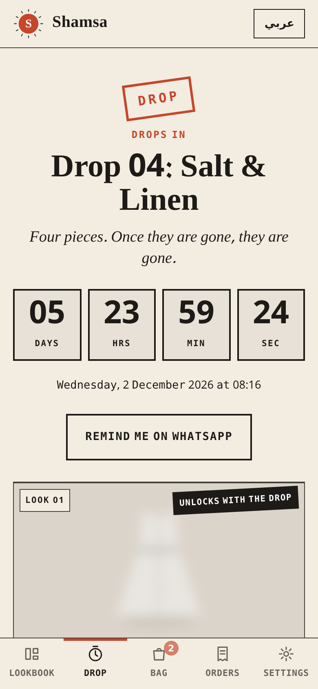
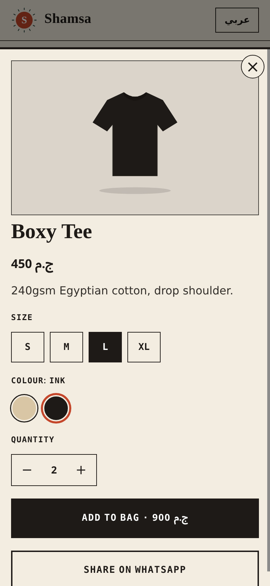
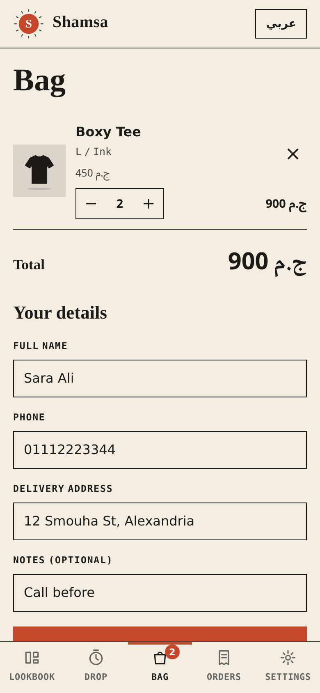
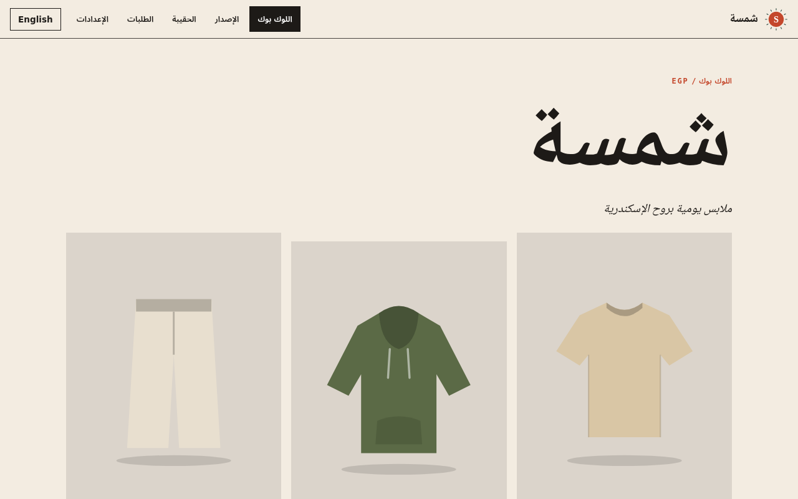
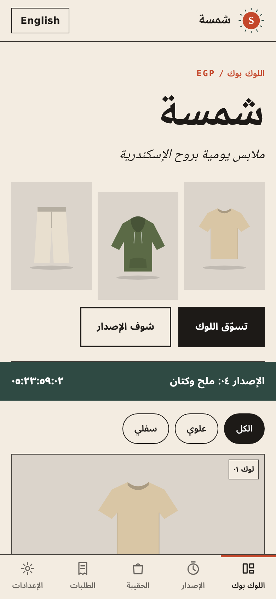

<p align="center"></p>

<h1 align="center">Brand</h1>

<p align="center"><strong>A white-label page for a small clothing brand: lookbook, drop countdown, and orders that arrive on WhatsApp.</strong><br>
Arabic and English, right-to-left ready, built for phones. No server, no account, no cost.</p>

<p align="center"><a href="https://yousefkhames.github.io/brand/"><b>Open the live demo</b></a> ·
<a href="https://yousefkhames.github.io/brand/#/settings">Try the settings screen</a></p>

<p align="center">




</p>

## Screenshots

Captured from the live site (https://yousefkhames.github.io/brand/).

<p>
  
  
</p>

## The pitch

Most small clothing brands in Egypt sell through Instagram DMs and WhatsApp. They do not need a full web shop, they need a clean page that shows the pieces, builds hype for a drop, and turns a tap into a ready-to-send WhatsApp order.

Brand is that page. Change the name, logo, colours, currency, language and products in a settings screen, export the result as a file, and you have a branded storefront for the next client.

## Features

- **Lookbook.** Editorial grid, category filters, a product sheet with size, colour and quantity.
- **Drop page.** Live countdown to a date you set. Drop-only pieces stay locked (blurred, not orderable) until the timer ends, then open up on their own.
- **WhatsApp ordering.** The bag builds a full order message (items, options, total, customer details, order number) and opens `wa.me` with the shop's number. Validation, phone normalisation (`010...` becomes `2010...`), and a copy-message fallback.
- **Order log.** Orders sent from the device are listed with a status you can change, and exported as CSV.
- **Share a piece.** One tap shares a product and the page link on WhatsApp.
- **Settings for white-labelling.** Brand name and tagline in both languages, letter logo or uploaded logo, four colours with five ready palettes and a contrast warning, currency code, symbol and position, shop WhatsApp number, country code, default language, Instagram handle, the drop (title, blurb, date), and a full product editor (add, edit, delete, photo upload, sold out, drop flag).
- **Export and import.** Brand kit (branding, drop, products, no customer data) or full backup as JSON. Import is validated and sanitised.
- **Arabic and English.** Full translation, real RTL layout, Arabic-Indic digits and separators in Arabic mode.
- **Offline-capable.** A small service worker caches the app after the first visit.
- **Accessible basics.** Keyboard operation, focus trap and focus return in dialogs, Escape to close, visible focus, reduced-motion support, skip link.

## Tech

Plain HTML, CSS and JavaScript, no build step and no dependencies.

| File | Role |
| --- | --- |
| `js/lib.js` | Pure logic: countdown, drop locking, cart, totals, order message, phone and price formatting, import sanitising, CSV |
| `js/art.js` | Original SVG garment drawings and the generated logo |
| `js/i18n.js` | Arabic and English strings |
| `js/app.js` | Views, events, settings, localStorage |
| `sw.js` | Offline cache |

Data lives in `localStorage` (`brand.v1`). Nothing is sent anywhere. The only network action is opening a WhatsApp link when you press order.

## Run and test

```bash
python3 -m http.server 8080      # or any static server
npm test                          # 13 unit tests (node:test), no packages needed
node tests/e2e.mjs http://localhost:8080/   # real Chrome click-through, needs google-chrome
```

The end-to-end script drives a real headless Chrome over the DevTools protocol: language switch, filters, product sheet, drop locking and ticking countdown, validation, the exact `wa.me` link and message, order log, white-label settings, adding a product, changing the drop date, export and import, Arabic editor, and a check for JavaScript errors. It also runs against the live GitHub Pages URL.

## Honest limits

- It is a front end only. There is no payments, stock sync, accounts or admin login. Anyone who opens the page can open its Settings screen, and their changes stay in their own browser.
- Because data is per-browser, a shop owner edits on one device and exports the kit; to publish changes to customers you replace the default content in `js/lib.js` (or ship the exported kit) and redeploy. Brand does not push edits to other visitors.
- Orders are only as reliable as WhatsApp: the app opens a pre-filled chat, the customer still has to press send. The order log records what was prepared on that device, not what was received.
- Clearing browser data erases the log and edits. Export a backup.
- Product images are drawn silhouettes unless you upload photos. Uploaded photos are shrunk and stored in `localStorage`, which is limited (about 5 MB), so keep them few.
- Prices are plain numbers in one currency. No tax, shipping, discounts or variants with their own stock.
- Tested in headless Chrome and by reading the layout at phone and desktop widths. Not tested on Safari or Firefox.

## Licence

MIT, see [LICENSE](LICENSE).
